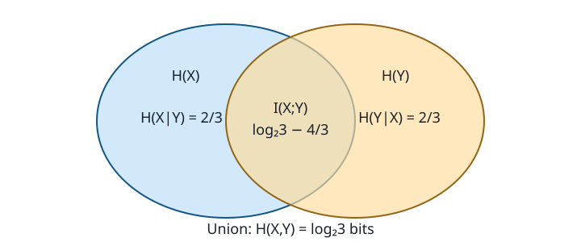

# Exercise 2.12: A three-point joint distribution

Source: Cover and Thomas, *Elements of Information Theory*, 2nd ed. (2006), printed pp. 46. Logarithms are base 2 unless explicitly written as ln.

## Solution

The table has mass $`1/3`$ at $`(0,0),(0,1),(1,1)`$ and zero elsewhere. Write $`L=\log_2 3`$.

## (a)
The two marginal mass vectors are $`(2/3,1/3)`$ and $`(1/3,2/3)`$. Consequently $`H(X)=H(Y)=L-2/3\approx0.918296`$ bits.

## (b)
Given $`Y=0`$, $`X`$ is certain; given $`Y=1`$, it is fair. Thus $`H(X\mid Y)=(2/3)\cdot1=2/3`$. The analogous calculation gives $`H(Y\mid X)=2/3`$.

## (c)
There are three equiprobable supported pairs, so $`H(X,Y)=L\approx1.584963`$.

## (d)
$`H(Y)-H(Y\mid X)=L-4/3\approx0.251629`$ bits.

## (e)
The same difference is $`I(X;Y)=L-4/3`$.

## (f)
The following Venn diagram labels the two conditional-entropy regions and the mutual-information overlap. Each whole circle has area-label $`L-2/3`$, and the union has total label $`L`$; the drawing is schematic, not to scale.

The numerical values are independently recomputed by [ch02.py](../../src/information_theory/ch02.py) and saved in [results.json](../../artifacts/ch02/results.json).
