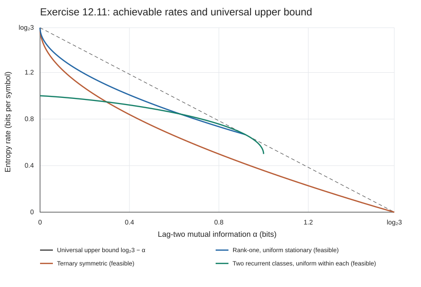

# Exercise 12.11: Entropy rate with prescribed lag-two information

Source: Cover and Thomas, *Elements of Information Theory*, 2nd ed. (2006), printed p. 423. Logarithms are base 2.

## Solution

Write $`F(\alpha)`$ for the largest entropy rate of a stationary three-state Markov chain whose lag-two mutual information is $`\alpha`$. Stationary laws with absent states and reducible chains are allowed.

For (a), the answer is the independent uniform process, with entropy rate $`\log_2 3`$.

For (b), an **exact general answer by an explicit finite-enumeration limit** is given in (6) below. It applies to every allowed $`\alpha`$, proves attainment, and constructs maximizing chains as limits. This answer does not claim a closed-form classification of the maximizing transition matrices. The finite stages have proved constraint-error bounds; the convergence theorem does not supply a finite two-sided optimality-gap stopping rule. Some useful exact values are

```math
F(0)=\log_2 3,\qquad
F\bigl(h_2(1/3)\bigr)=\frac23,\qquad
F(\log_2 3)=0.                                      \tag{1}
```

The tempting answer $`\log_2 3-\alpha`$ is an upper bound, but is attained only at these three values. Nor is the uniform ternary-symmetric transition family globally optimal in general.

### 1. Basic bound, part (a), and equality cases

Let $`\pi`$ be the stationary distribution, $`P`$ the transition matrix, and $`h`$ the entropy rate. By the Markov property and conditioning,

```math
h=H(X_2\mid X_1,X_0)
 \le H(X_2\mid X_0)
 =H(\pi)-\alpha
 \le\log_2 3-\alpha.                                \tag{2}
```

At $`\alpha=0`$, the independent uniform process attains the bound. Conversely, $`h=\log_2 3`$ forces every positive-mass transition row to be uniform; its stationary distribution is uniform as well. Thus the maximizing process in (a) is uniquely the independent uniform process.

For equality in (2), $`\pi`$ must be uniform and $`X_1`$ and $`X_2`$ must be conditionally independent given $`X_0`$. Consequently, for each state $`i`$, all transition rows indexed by $`j`$ with $`P_{ij}>0`$ are identical. Partition the states into groups having identical transition rows. Each group sends all its probability to one group. Every group has positive stationary mass, so this map of groups is a permutation. Uniform stationarity requires source and destination groups to have the same size. Column sums of one then force the common transition row to be uniform over its destination group.

There are only three possible size partitions:

- One group of size 3 gives the independent uniform chain and $`\alpha=0`$.
- Groups of sizes 1 and 2 must each map to themselves. Up to relabeling, the transition matrix is

```math
P=\begin{pmatrix}1&0&0\\0&1/2&1/2\\0&1/2&1/2\end{pmatrix},
\qquad \pi=(1/3,1/3,1/3).
```

  It has $`\alpha=h_2(1/3)`$ and $`h=2/3`$.
- Three singleton groups give a permutation transition matrix, with $`\alpha=\log_2 3`$ and zero entropy rate.

This proves (1) and the asserted strictness of (2) elsewhere, once attainment is established below.

Every $`\alpha\in[0,\log_2 3]`$ is feasible: take $`P_t=(1-t)J/3+tI`$, $`\pi=(1/3,1/3,1/3)`$, and vary $`t`$ continuously from 0 to 1. Its squared transition matrix is $`(1-t^2)J/3+t^2I`$, and its lag-two information increases continuously from 0 to $`\log_2 3`$.

### 2. Stationary flows and an explicit finite grid

Use the stationary one-step joint distribution

```math
Q_{ij}=\Pr\{X_0=i,X_1=j\}=\pi_iP_{ij}.
```

The admissible $`Q`$ are exactly the nonnegative $`3\times3`$ matrices of total mass one whose row sums equal their corresponding column sums. Define

```math
\pi_i(Q)=\sum_jQ_{ij},\qquad
R_{ij}(Q)=\sum_{k:\,\pi_k(Q)>0}\frac{Q_{ik}Q_{kj}}{\pi_k(Q)},
```

and

```math
b(Q)=H(Q)-H(\pi(Q)),\qquad
 a(Q)=2H(\pi(Q))-H(R(Q)).                            \tag{3}
```

Here a matrix entropy means the entropy of its entries as one probability vector. Thus $`b(Q)`$ is the entropy rate and $`a(Q)`$ is the lag-two information. A zero-mass state contributes zero; its transition row can be chosen arbitrarily when reconstructing $`P`$.

There are eight normalized elementary directed cycles on three states. With $`E_{ij}`$ denoting the matrix with a single 1 in position $`(i,j)`$, they are

```math
\begin{aligned}
&C_1=E_{11},\ C_2=E_{22},\ C_3=E_{33},\\
&C_4=(E_{12}+E_{21})/2,\quad
 C_5=(E_{13}+E_{31})/2,\quad
 C_6=(E_{23}+E_{32})/2,\\
&C_7=(E_{12}+E_{23}+E_{31})/3,\qquad
 C_8=(E_{13}+E_{32}+E_{21})/3.
\end{aligned}
```

Every stationary flow is a convex combination of these eight matrices. To see this, follow positive edges of a nonzero balanced flow until a vertex repeats, subtract the smallest edge mass around the resulting simple directed cycle, and repeat. Balance is preserved, and at least one positive edge disappears each time. The removed cycle flows sum to $`Q`$; normalizing each cycle gives coefficients summing to one.

For a positive integer $`N`$, the following set is completely explicit and finite:

```math
\mathcal G_N=
\left\{\sum_{r=1}^{8}\frac{m_r}{N}C_r:
       m_r\in\{0,1,\ldots,N\},\quad\sum_{r=1}^{8}m_r=N\right\}.  \tag{4}
```

It requires at most $`\binom{N+7}{7}`$ evaluations; duplicate matrices do no harm. All matrix entries are rational with denominator dividing $`6N`$. There is no continuous constrained optimization at a finite stage.

### 3. The explicit answer and its error statements

Define the nondecreasing entropy-continuity modulus, for $`d\ge2`$ and $`t\ge0`$, by

```math
\omega_d(t)=
\begin{cases}
h_2(t)+t\log_2(d-1),&0\le t\le1-1/d,\\
\log_2d,&t\ge1-1/d.
\end{cases}
```

Set

```math
\begin{aligned}
\eta_N&=\omega_9(4/N)+\omega_3(4/N),\\
\rho_N&=2\omega_3(4/N)+\omega_9(12/N),\\
B_N(\alpha)&=
\max\{b(Q):Q\in\mathcal G_N,\ |a(Q)-\alpha|\le\rho_N\},\\
U_N(\alpha)&=\min\left\{\log_2 3-\alpha,
                 \min_{1\le n\le N}[B_n(\alpha)+\eta_n]\right\}.
                                                               \tag{5}
\end{aligned}
```

The sets in these maxima are nonempty. The answer for arbitrary $`\alpha`$ is

```math
\boxed{\displaystyle
F(\alpha)=\lim_{N\to\infty}U_N(\alpha)
         =\lim_{N\to\infty}B_N(\alpha),\qquad
U_N(\alpha)\downarrow F(\alpha).}                    \tag{6}
```

These are finite maxima of explicitly listed entropy expressions, followed by a proved limit. They include nonuniform, irreversible, periodic, reducible, and boundary-supported chains.

If $`Q_N`$ is any maximizing grid element in the definition of $`B_N`$, it yields an actual stationary Markov chain with

```math
|a(Q_N)-\alpha|\le\rho_N,\qquad
b(Q_N)\ge F(\alpha)-\eta_N.                           \tag{7}
```

Every accumulation point $`Q_*`$ of this explicit sequence is an exact optimizer. Set $`\pi_i=\sum_j(Q_*)_{ij}`$ and $`P_{ij}=(Q_*)_{ij}/\pi_i`$ on positive-mass states to obtain a maximizing process. Different accumulation points, if present, all have the required information and optimal entropy rate.

**Interpretation of the guarantee.** At finite $`N`$, (7) permits a small error in the information constraint. It does not assert that the grid chain is exactly feasible, or that $`B_N\le F`$. Formula (6) is a globally convergent exact-limit solution, rather than a closed-form transition-matrix classification or an efficient finite-accuracy solver. The bounds in (5) are mathematical bounds with exact entropy evaluation. Ordinary machine floating-point evaluations are verification only; numerical certification would require outward-rounded entropy intervals and retaining every grid point whose constraint interval overlaps the admissible window.

### 4. Proof of the limit formula

**Grid approximation.** Given $`Q=\sum_r\lambda_rC_r`$, round $`N\lambda_r`$ down and distribute the remaining integer units to the largest fractional remainders. The resulting $`m_r`$ satisfy

```math
\sum_rm_r=N,\qquad |m_r/N-\lambda_r|\le1/N.
```

Because each $`C_r`$ has entrywise $`\ell^1`$ norm one, its grid approximation $`Q^{(N)}`$ satisfies

```math
\mathrm{TV}(Q,Q^{(N)})
\le\frac12\sum_r|\lambda_r-m_r/N|\le4/N.             \tag{8}
```

**Continuity of two-step flows, including absent states.** If $`Q,Q'`$ are stationary flows, then

```math
\|R(Q)-R(Q')\|_1\le3\|Q-Q'\|_1.                    \tag{9}
```

For detail, let $`T_{ikj}=Q_{ik}P_{kj}`$ be the joint law of three successive states. Add and subtract $`Q'_{ik}P_{kj}`$, use the triangle inequality, and sum:

```math
\|T-T'\|_1
\le\|Q-Q'\|_1+\sum_k\pi'_k\|P_{k\cdot}-P'_{k\cdot}\|_1
\le2\|Q-Q'\|_1+\|\pi-\pi'\|_1
\le3\|Q-Q'\|_1.
```

The middle inequality follows from
$`\pi'_k(P_{k\cdot}-P'_{k\cdot})
=(Q_{k\cdot}-Q'_{k\cdot})+(\pi'_k-\pi_k)P_{k\cdot}`$.
It remains valid with arbitrary stochastic rows at zero-mass states. Marginalizing out $`k`$ proves (9).

For distributions on $`d`$ points at total variation distance at most $`t`$, the entropy difference is at most $`\omega_d(t)`$. One proof couples the variables with disagreement probability equal to their total variation distance, uses the disagreement indicator, and bounds the conditional entropy on disagreement by $`\log_2(d-1)`$. Above $`1-1/d`$, use the trivial entropy range $`[0,\log_2d]`$. Marginalization contracts total variation, so (3), (8), and (9) give

```math
|b(Q)-b(Q^{(N)})|\le\eta_N,\qquad
|a(Q)-a(Q^{(N)})|\le\rho_N.                         \tag{10}
```

The stationary-flow polytope is compact. Equations (9) and (3) show that both objectives are continuous even on its boundary. The nonempty level set $`a(Q)=\alpha`$ is therefore compact, and its maximum entropy rate $`F(\alpha)`$ is attained. Round such an optimizer using (8). It belongs to the window in (5), proving both nonemptiness and

```math
B_N(\alpha)+\eta_N\ge F(\alpha).                    \tag{11}
```

Conversely, choose a maximizing $`Q_N`$ from each finite grid window. Along any convergent subsequence, $`\rho_N\to0`$ gives $`a(Q_*)=\alpha`$. Continuity gives
$`\lim b(Q_N)=b(Q_*)\le F(\alpha)`$ along that subsequence. Together with (11) and $`\eta_N\to0`$, compactness forces the entire scalar sequence $`B_N`$ to converge to $`F`$, and all its matrix accumulation points to be optimal. Taking the running minimum of valid upper bounds proves (6).

### 5. Explicit feasible chains and why symmetry is insufficient

A useful rank-one family has parameters $`0<p<1`$, $`0\le t\le1`$:

```math
\pi=(p,(1-p)/2,(1-p)/2),\qquad
P_{p,t}=\begin{pmatrix}
p+(1-p)t&(1-p)(1-t)/2&(1-p)(1-t)/2\\
p(1-t)&(1-p+pt)/2&(1-p+pt)/2\\
p(1-t)&(1-p+pt)/2&(1-p+pt)/2
\end{pmatrix}.                                    \tag{12}
```

The two-state class label is Markov; within the second class the output is freshly uniform. Also $`P_{p,t}^2=P_{p,t^2}`$. Its rate and information are therefore

```math
\begin{aligned}
h(p,t)&=p\,h_2(p+(1-p)t)+(1-p)h_2(p(1-t))+1-p,\\
a(p,t)&=h_2(p)-p\,h_2(p+(1-p)t^2)-(1-p)h_2(p(1-t^2)).
\end{aligned}                                    \tag{13}
```

For fixed $`p`$, $`a(p,t)`$ increases continuously from zero to $`h_2(p)`$. Thus a scalar root gives an exactly defined feasible lower bound for any $`\alpha`$ in this range. At $`t=1`$, it is the reducible chain with rate $`1-p`$ and information $`h_2(p)`$. For larger information one may also use an absorbing singleton of stationary mass $`p`$ and a binary symmetric chain on the other two states. If the binary chain has transition probabilities $`(1\pm t)/2`$, then

```math
h=(1-p)h_2((1-t)/2),\qquad
\alpha=h_2(p)+(1-p)[1-h_2((1-t^2)/2)].              \tag{14}
```

These are achievable families, not a claim that their envelope is the global answer.

A rigorous diagnostic is the exact leading behavior

```math
\boxed{F(\alpha)=\log_2 3-
       \sqrt{\frac{\alpha}{2\ln2}}+o(\sqrt\alpha)
       \quad(\alpha\downarrow0).}                  \tag{15}
```

To prove the upper restriction in (15), consider optimizers as $`\alpha\downarrow0`$. The family (12) with $`p=1/3`$ shows that their rates tend to $`\log_2 3`$. Hence their stationary distributions tend to uniform and their transition matrices tend to the independent uniform matrix: indeed $`h\le H(\pi)\le\log_2 3`$ and $`H(\pi)-h=I(X_0;X_1)\to0`$.

Put $`E=\mathbf1\pi`$, $`D_\pi=\mathrm{diag}(\pi)`$, and
$`B=D_\pi^{1/2}(P-E)D_\pi^{-1/2}`$; all stationary masses are bounded away from zero in this limit. Since $`P^2=E+(P-E)^2`$, the relative-entropy Taylor expansions, uniformly near the independent uniform law, give

```math
I(X_0;X_1)=\left(\frac1{2\ln2}+o(1)\right)\|B\|_F^2,
\qquad
\alpha=\left(\frac1{2\ln2}+o(1)\right)\|B^2\|_F^2.
```

The Frobenius inequality $`\|B^2\|_F\le\|B\|_F^2`$ and
$`\log_2 3-h\ge I(X_0;X_1)`$ yield the lower bound on the entropy deficit in (15). For the matching construction, take $`p=1/3`$ in (12). Then
$`P=J/3+t vv^T`$ with $`v=(2,-1,-1)/\sqrt6`$. It has
$`\log_2 3-h=t^2/(2\ln2)+O(t^3)`$ and
$`\alpha=t^4/(2\ln2)+O(t^6)`$, proving (15).

By contrast, the ternary-symmetric family $`(1-t)J/3+tI`$ has entropy deficit
$`\sqrt{\alpha/\ln2}+o(\sqrt\alpha)`$, strictly worse near zero.

### Numerical reproduction

Run the standard-library-only experiment:

```sh
PYTHONPATH=src python -m information_theory run information_theory.experiments.ch12_markov --output artifacts/ch12/ex-12-11
PYTHONPATH=src python -m unittest tests.test_ch12_markov -v
```

The [recorded run](../../artifacts/ch12/ex-12-11/results.json) checks all eight cycle flows, grid size, zero-mass conventions, quantization and two-step continuity samples, explicit feasible chains, and the small-information expansion. These are floating-point checks of the proof and constructions, not numerical global optimality certificates.

For example, at $`\alpha=0.001`$ the ternary-symmetric chain gives rate approximately $`1.5484468663`$, whereas (12) with $`p=1/3`$ gives $`1.5585632471`$. At $`\alpha=0.2`$, the uniform-stationary rank-one chain gives $`1.1886729196`$; choosing the explicit rational value $`p=0.29610602`$ and the unique root of $`a(p,t)=0.2`$ gives $`1.1923138690`$. Thus even restricting to uniform stationary laws would discard useful feasible chains.

The following curves show feasible families and (2); none of the solid curves is labeled as the general optimum.


