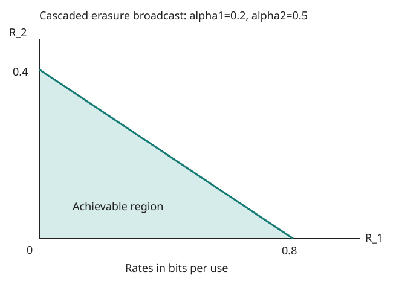

# Exercise 15.21: Cascaded binary erasure broadcasting

Source: Cover and Thomas, 2nd ed. (2006), p. 604, Exercise 15.21. The diagram preserves an existing erasure with probability one at the second stage.

## Solution

### (a) First receiver

The first marginal channel is a binary erasure channel with survival probability $`c_1=1-\alpha_1`$. For any input law, $`I(X;Y_1)=c_1H(X)`$, maximized by a fair bit. Its capacity is $`c_1`$ bits per use.

### (b) Second receiver

A bit survives exactly when neither stage erases, giving $`c_2=(1-\alpha_1)(1-\alpha_2)`$. Thus $`I(X;Y_2)=c_2H(X)`$ and the second capacity is $`c_2`$.

### (c) Region and sketch

For $`c_1,c_2>0`$, the exact region is

```math
R_1,R_2\ge0,\qquad \frac{R_1}{c_1}+\frac{R_2}{c_2}\le1.
```

Indeed, for every $`U\to X\to(Y_1,Y_2)`$, independent erasure gives

```math
I(X;Y_1\mid U)=c_1H(X\mid U),\qquad
I(U;Y_2)=c_2I(U;X).
```

The degraded broadcast bounds therefore imply that the normalized sum is at most $`H(X\mid U)+I(U;X)=H(X)\le1`$. Time-sharing capacity-achieving fair-bit codes for the two individual receivers attains the line between $`(c_1,0)`$ and $`(0,c_2)`$, so the bound is sharp. The region is the triangle below this line and above the nonnegative axes.

If $`c_1=0`$, both capacities vanish. If $`c_1>0,c_2=0`$, the region is $`0\le R_1\le c_1,R_2=0`$. If the second stage never erases, the two intercepts coincide and the sum bound is $`R_1+R_2\le c_1`$.

## Reproducible sketch



The figure uses $`\alpha_1=0.2,\alpha_2=0.5`$, yielding intercepts $`0.8`$ and $`0.4`$ bits per use. It illustrates the analytic result rather than numerically proving it.

```sh
PYTHONPATH=src python -m information_theory run information_theory.experiments.ch15_batch3 --output artifacts/ch15/batch3
```

[Run record](../../artifacts/ch15/batch3/results.json) includes the calculation and frozen source/figure hashes; the calculation is deterministic.
