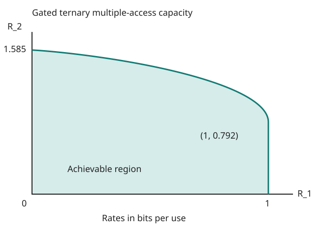

# Exercise 15.23: A gated ternary multiple-access channel

Source: Cover and Thomas, 2nd ed. (2006), p. 605, Exercise 15.23. Let $`L=\log_2 3`$.

## Solution

Set $`p=P(X_1=1)`$ and let $`H_2=H(X_2)`$. Since $`X_2`$ is never zero, the output always reveals $`X_1`$. If $`X_1=1`$ it also reveals $`X_2`$. For independent inputs,

```math
I(X_1;Y\mid X_2)=h_2(p),\qquad
I(X_2;Y\mid X_1)=pH_2,\qquad
I(X_1,X_2;Y)=h_2(p)+pH_2.
```

The sum constraint is redundant. A uniform ternary second input maximizes $`H_2=L`$ simultaneously in every bound. Hence

```math
\mathcal C=\bigcup_{0\le p\le1}
\{(R_1,R_2):0\le R_1\le h_2(p),\ 0\le R_2\le pL\}.
```

This union is already convex. A convex combination of points from parameters $`p_a,p_b`$ has second coordinate at most $`\bar pL`$ and first coordinate at most $`\lambda h_2(p_a)+(1-\lambda)h_2(p_b)\le h_2(\bar p)`$, where $`\bar p=\lambda p_a+(1-\lambda)p_b`$. Therefore no extra points arise by time-sharing, and the MAC theorem makes the displayed set exact.

An explicit boundary description is

```math
0\le R_2\le L,\qquad
0\le R_1\le
\begin{cases}
1,&0\le R_2\le L/2,\\
h_2(R_2/L),&L/2\le R_2\le L.
\end{cases}
```

For a fixed $`R_2`$ one maximizes $`h_2(p)`$ over $`p\ge R_2/L`$, giving these two cases. Thus a sketch consists of the right edge $`R_1=1`$ up to $`R_2=L/2`$, followed by the curve $`(h_2(p),pL)`$, $`1/2\le p\le1`$, ending at $`(0,L)`$. The feasible region lies to the left and below. Its maximum sum is two bits: $`p=3/4`$ makes all four output symbols uniform, and no four-valued output can exceed two bits.

## Reproducible sketch and values



The deterministic calculation gives $`L=1.584962500721156`$. The unit-first-rate corner is $`(1,0.792481250360578)`$. At the maximum-sum point, the rates are $`(0.811278124459133,1.188721875540867)`$, adding to two bits. A 1,001-point parameter grid checks the formula's sum bound as a numerical consistency check; the entropy proof establishes it for all inputs.

```sh
PYTHONPATH=src python -m information_theory run information_theory.experiments.ch15_batch3 --output artifacts/ch15/batch3
```

[Run record](../../artifacts/ch15/batch3/results.json) contains values, checks, and frozen source/figure hashes. No random sampling is used.
