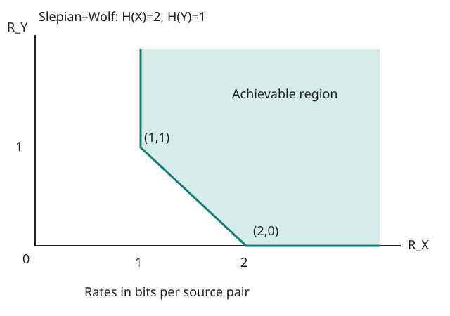

# Exercise 15.8: A deterministic source relation

Source: Cover and Thomas, 2nd ed. (2006), p. 598, Exercise 15.8. Let $`Y=f(X)`$ and suppose the relevant discrete entropies are finite.

## Solution

Since $`H(Y\mid X)=0`$ and $`H(X,Y)=H(X)`$, the closed Slepian–Wolf region is

```math
R_X\ge H(X)-H(Y),\qquad R_Y\ge0,\qquad R_X+R_Y\ge H(X).
```

These follow by inserting the deterministic relation in the three Slepian–Wolf inequalities, whose achievability and converse apply to the i.i.d. source. The lower boundary is the line segment from $`(H(X)-H(Y),H(Y))`$ to $`(H(X),0)`$, followed by the rightward horizontal ray. A vertical ray rises from the first endpoint; the feasible region is above and to the right. If $`H(Y)=0`$ the segment collapses and $`R_X\ge H(X)`$. If $`H(Y)=H(X)`$, the sum constraint alone, with nonnegative rates, remains.

## Reproducible sketch



The illustration uses $`H(X)=2`$, $`H(Y)=1`$, realizable by two independent fair bits with $`Y`$ the first bit. Its vertices are $`(1,1)`$ and $`(2,0)`$; the formulas above specify all other entropy values. The deterministic generator checks those inequalities at its boundary vertices; the sketch is not used as proof.

Run from the repository root:

```sh
PYTHONPATH=src python -m information_theory run information_theory.experiments.ch15_batch1 --output artifacts/ch15/batch1
```

[Run record](../../artifacts/ch15/batch1/results.json) records the fixed calculation, source hashes, and SVG hash. No random sampling or seed is needed.
