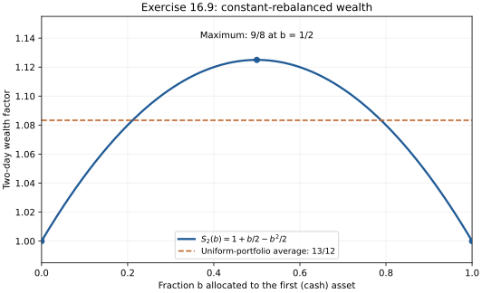

# Exercise 16.9: A two-day universal portfolio calculation

Source: Cover and Thomas, *Elements of Information Theory*, 2nd ed. (2006), printed p. 654.

## Solution

Let $`b`$ denote the fraction in the first asset, and $`1-b`$ the fraction in the second.

### (a)
The one-day and two-day constant-rebalanced wealth functions are

```math
S_1(b)=\frac{1+b}{2},\qquad
S_2(b)=\frac{1+b}{2}(2-b)=1+\frac b2-\frac{b^2}{2}.
```

The graph is a concave parabola, equal to 1 at both endpoints and maximized at the midpoint:



### (b)
Differentiating gives $`S_2'(b)=1/2-b`$. Thus $`b_*=1/2`$ and $`S_2^*=9/8`$.

### (c)
The logarithm is a sum of logarithms of positive affine functions,
$`\ln S_2(b)=\ln(1+b)+\ln(2-b)-\ln2`$. Explicitly,

```math
\frac{d^2}{db^2}\ln S_2(b)
=-\frac1{(1+b)^2}-\frac1{(2-b)^2}\lt 0.
```

Changing the logarithm base multiplies this by a positive constant, preserving strict concavity.

### (d)
The uniform mixture of constant-rebalanced portfolios has wealth

```math
\widehat S_2=\int_0^1S_2(b)\,db
=1+\frac14-\frac16=\frac{13}{12}.
```

### (e)
The first allocation is $`\widehat b_1=\int_0^1b\,db=1/2`$. After the first day's outcome, wealth-weighting the portfolios gives

```math
\widehat b_2
=\frac{\int_0^1b(1+b)/2\,db}{\int_0^1(1+b)/2\,db}
=\frac{5/12}{3/4}=\frac59.
```

These are first-asset fractions; the full allocations are $`(1/2,1/2)`$ and $`(5/9,4/9)`$. Directly trading them gives $`(3/4)(5/9+2\cdot4/9)=13/12`$, agreeing with the mixture integral.

### (f)
Reversing the market outcomes leaves $`S_2(b)`$ unchanged for every $`b`$, because the two factors commute. Therefore $`S_2^*`$ and $`\widehat S_2`$ are unchanged as well. The second-day allocation depends on the first outcome, so it changes:

```math
\widehat b_2^{\rm reversed}
=\frac{\int_0^1b(2-b)\,db}{\int_0^1(2-b)\,db}
=\frac{2/3}{3/2}=\frac49.
```

The first allocation remains uniform; the reversed second allocation is $`(4/9,5/9)`$, and its final wealth is again $`13/12`$.


## Reproducible calculation

Run `PYTHONPATH=src python -m information_theory run information_theory.experiments.ch16_portfolio --output artifacts/ch16/portfolio`. The [experiment](../../src/information_theory/experiments/ch16_portfolio.py) computes the rational answers exactly and checks the rebalancing identities. [Recorded results](../../artifacts/ch16/portfolio/results.json) include seed 0 (no randomness), environment, source hashes, and plot hashes. Three chapter-specific unit tests cover these identities.
